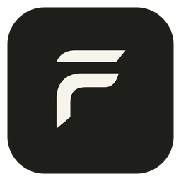
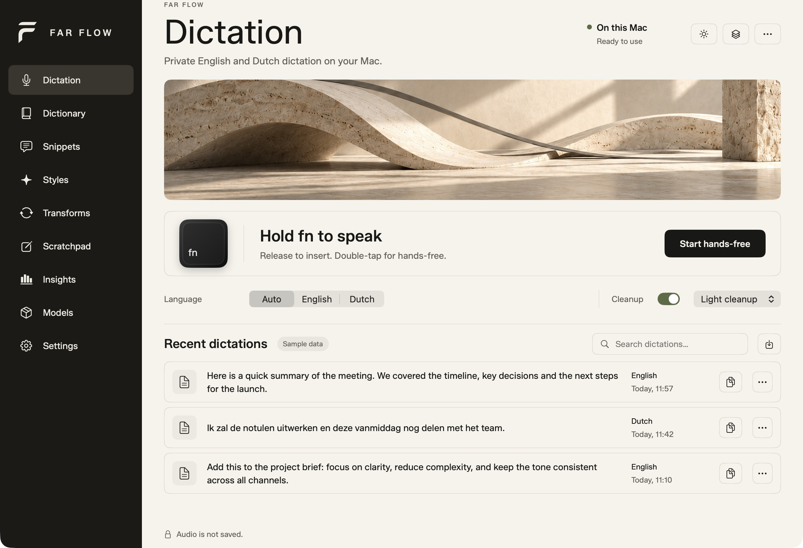
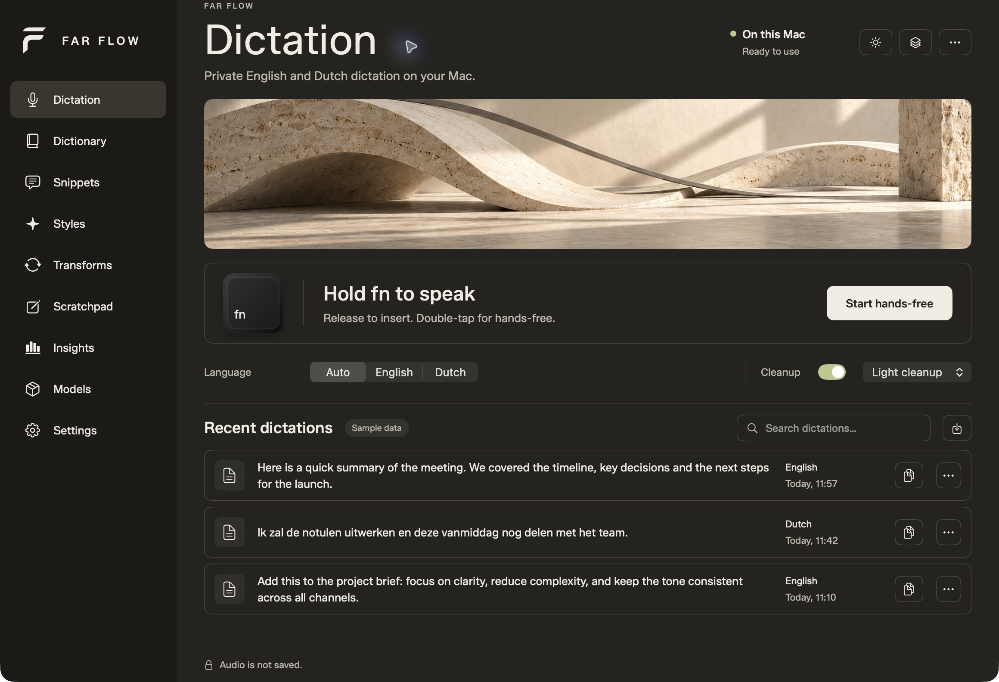

<p align="center">
  
</p>
<h1 align="center">Far Flow</h1>
<p align="center"><strong>Your voice. On your Mac.</strong><br>Native English and Dutch dictation with local speech recognition and optional local AI writing.</p>
<p align="center">
  
  
  
  
</p>



<p align="center"><em>The real native app, shown with sample dictations. Screenshots are cropped to the app workspace.</em></p>

## Speak where you write

Hold **Fn** to dictate and release to insert at your cursor. **Double-tap Fn** for hands-free recording, then press it once to finish. Far Flow stays in the background while you work.

English, Dutch and mixed speech are transcribed on your Mac. The small, movable availability bar expands into a waveform while recording. Original recognition and cleaned text remain available in local history when retention is enabled.

## Features

- **Local dictation** — Parakeet v3 through Core ML, with no cloud inference fallback.
- **Fast cleanup** — standard Light cleanup uses local rules; deeper cleanup and writing styles use an optional Qwen model through MLX.
- **Cursor insertion** — Accessibility-based insertion with destination checks and copy recovery when a field cannot be verified.
- **Hands-free controls** — Fn hold, double-tap, Escape cancellation and alternative keyboard shortcuts.
- **A quiet desktop presence** — draggable idle bar, waveform-only recording, and optional pause/resume for the macOS Now Playing player.
- **A personal writing workspace** — dictionary, exact-match snippets, app styles, reviewed selection transforms, scratchpad and local insights.
- **Control over your data** — configurable transcript retention, JSON backup/import and model verification.
- **A native studio interface** — ivory and charcoal, a flowing F mark, sculptural banner artwork, light/dark appearance and Reduce Motion support.

<details>
<summary><strong>See dark appearance</strong></summary>



</details>

## Build in Xcode

**Source preview · version 0.2.1.** There is no notarized public installer yet. The current target is **macOS 26+ on Apple Silicon**; development was verified on an M4 Mac with 16 GB RAM and Xcode 26.6.

Install full Xcode, its command-line tools and [XcodeGen](https://github.com/yonaskolb/XcodeGen), then:

```sh
git clone https://github.com/Farazs27/far-flow.git
cd far-flow
./scripts/build.sh
```

Open `FarFlow.xcodeproj`, choose the **FarFlow** scheme and **My Mac**, and run. If MLX reports a missing Metal toolchain, install it with `xcodebuild -downloadComponent MetalToolchain`.

For an Applications-folder installation, quit any running copy and run `./scripts/install.sh`. The build script uses an available local signing identity, or falls back to ad hoc signing. A stable development identity helps macOS recognize permissions across rebuilds.

On first launch:

1. Grant **Microphone** and **Accessibility**. This shortcut implementation does not require a separate Input Monitoring grant.
2. Install the speech model from **Models**. Install the writing model if you want deeper cleanup or transforms.
3. For Fn, set macOS **Keyboard → Press 🌐 key to → Do Nothing** to prevent the language-switch popup.
4. Put your cursor in another app, hold Fn, speak and release.

[Detailed build guide](docs/BUILDING.md) · [Usage and troubleshooting](docs/USING-FAR-FLOW.md)

## Local by design

Model downloads are explicit and require a connection. Once the required files are installed, speech recognition, cleanup and writing use local files. No account, inference API key or inference subscription is required.

Audio is held in memory and discarded after processing or cancellation. Retained transcripts, preferences and models live in `~/Library/Application Support/FarFlow/`. The database is protected by your macOS account; Far Flow does not add its own database encryption.

**Closing the main window quits Far Flow and stops its model host.** Minimize the window to keep Fn and the floating bar available.

[Privacy and data lifecycle](docs/PRIVACY.md) · [Architecture](docs/ARCHITECTURE.md)

## Verification and current limits

The native Release build and code signature have been verified. The core test suite passed **50 tests**. Offline benchmarks cover 18 synthetic English/Dutch clips and 200 repeated speech transcriptions. They measure components, not full microphone-to-cursor latency or personal-voice accuracy.

The XCTest UI target is included, but UI automation could not be enabled on the development Mac. Live native checks covered dictation controls, insertion, media pause/resume and process shutdown. A broader editor compatibility matrix and longer daily-use pilot remain. The media integration uses a version-dependent macOS private API.

[Verification details and reproducible benchmark steps](docs/VERIFICATION.md)

## Repository map

| Path | Purpose |
| --- | --- |
| `FarFlow/` | SwiftUI workspace, recording, shortcuts and insertion |
| `FarFlowCore/` | Local inference, cleanup, model installation and SQLite persistence |
| `FarFlowMediaBridge/` | Local Now Playing transport |
| `FarFlowTests/`, `FarFlowUITests/` | Unit and native UI test targets |
| `FarFlowBench/`, `Benchmarks/` | Synthetic corpus and component measurements |
| `project.yml`, `FarFlow.xcodeproj/` | XcodeGen definition and editable Xcode project |
| `docs/` | Build, usage, privacy, architecture and screenshots |

## Rights and acknowledgments

**All rights reserved.** This is a publicly viewable source repository, not a permissively licensed open-source project. Original Far Flow code, branding and artwork remain reserved; see [LICENSE](LICENSE).

Third-party libraries, fonts and separately downloaded models retain their own licenses. See [third-party notices](docs/THIRD-PARTY-NOTICES.txt). Far Flow is an independent app and is not affiliated with Wispr Flow.
