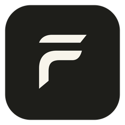
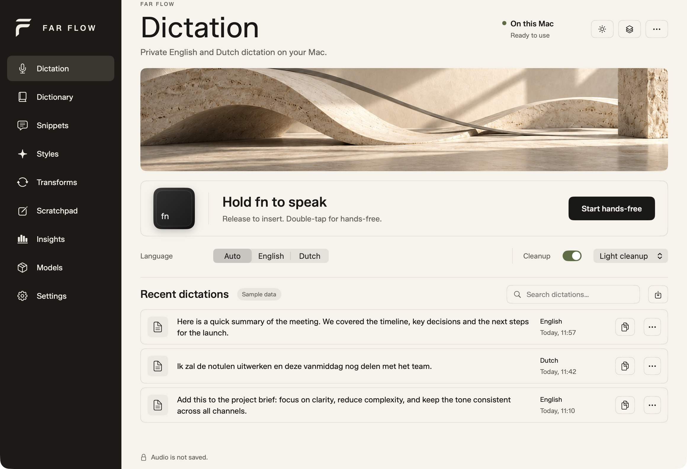
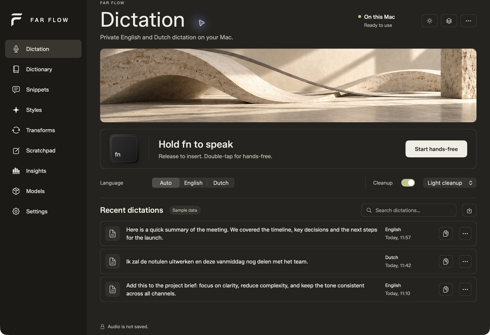

<p align="center">
  
</p>
<h1 align="center">Far Flow</h1>
<p align="center"><strong>Your voice. On your Mac.</strong><br>Native English and Dutch dictation with local speech recognition and optional local AI writing.</p>
<p align="center">
  
  
  
  
</p>



<p align="center"><em>The real native app, shown with sample dictations. Screenshots are cropped to the app workspace.</em></p>

## Speak where you write

Hold **Fn** to dictate and release to insert at your cursor. **Double-tap Fn** for hands-free recording, then press it once to finish. Far Flow stays in the background while you work.

English, Dutch and mixed speech are transcribed on your Mac. The small, movable availability bar expands into a waveform while recording. Original recognition and cleaned text remain available in local history when retention is enabled.

## Features

- **Local dictation** — Parakeet v3 through Core ML, with no cloud inference fallback.
- **Fast cleanup** — standard Light cleanup uses local rules; deeper cleanup and writing styles use an optional Qwen model through MLX.
- **Cursor insertion** — Accessibility-based insertion with destination checks and copy recovery when a field cannot be verified.
- **Hands-free controls** — Fn hold, double-tap, Escape cancellation and alternative keyboard shortcuts.
- **A quiet desktop presence** — draggable idle bar, waveform-only recording, and optional pause/resume for the macOS Now Playing player.
- **Local meeting notes** — selected-app audio plus microphone, timestamped transcripts, interruption recovery, editable notes and on-device summaries.
- **A personal writing workspace** — dictionary, exact-match snippets, app styles, reviewed selection transforms, searchable notes and local insights.
- **Control over your data** — configurable transcript retention, JSON backup/import and model verification.
- **A native studio interface** — ivory and charcoal, a flowing F mark, sculptural banner artwork, light/dark appearance and Reduce Motion support.

<details>
<summary><strong>See dark appearance</strong></summary>



</details>

## Install with an AI assistant — follow these steps exactly

Give Claude, Codex or another **local coding assistant with terminal access** this repository URL and this instruction:

> Install Far Flow from https://github.com/Farazs27/far-flow using its README installation procedure. Inspect my Mac first. Use the existing app, pinned dependencies and pinned models; do not redesign it, substitute models, change the bundle ID or deployment target, or create a web version. Run the prerequisite check, build and tests, install it, verify the models, then guide me through macOS permissions and a short English/Dutch recording check. Preserve existing Far Flow data. Report any step that could not be verified. Never disable Gatekeeper or SIP, remove quarantine to bypass a warning, upload my recordings, or claim production verification without the release checks.

A web-only chat cannot install software on your Mac. Use an assistant with local terminal access, or run the commands yourself. Administrator passwords, Apple sign-in, legal terms and macOS permission approvals belong to the Mac owner.

### 1. Check the Mac before installing anything

```sh
uname -m
sw_vers -productVersion
sysctl -n hw.memsize
df -h .
xcode-select -p
xcodebuild -version
```

| Requirement | What to do if missing |
| --- | --- |
| **Apple Silicon** (`arm64`, M1 or newer) | Intel Macs are unsupported. If this is an Apple Silicon Mac running a Rosetta terminal, reopen a native terminal. Do not change the architecture to x86_64. |
| **macOS 26 or newer** | Ask the owner to update macOS using System Settings if their Mac supports it. Otherwise stop; do not lower the deployment target. |
| **16 GB unified memory for the validated full workflow** | 8 GB Macs can use speech/transcripts with manual summaries; that hardware profile still needs real-call validation. Below 8 GB is unsupported. More RAM does not need a larger model. |
| **Full Xcode 26**, verified with **26.6** | Install Xcode from the Mac App Store or [Apple Developer downloads](https://developer.apple.com/download/all/), open it, and let the owner complete first-launch setup and terms. Command Line Tools alone are insufficient. |
| **Metal toolchain** | Run `xcodebuild -downloadComponent MetalToolchain` if missing. |
| **XcodeGen**, verified with **2.46.0** | Install using `brew install xcodegen`. If Homebrew is absent, use its official installation instructions at [brew.sh](https://brew.sh/); the owner approves system changes. |
| **Python 3** | `python3 --version`; if absent, `brew install python`. No Python packages, virtual environment, Node, Docker, Ollama or inference API key are required. |
| **20 GB free after Xcode installation** | Free space first. Xcode itself requires additional space. Models total approximately 2.91 GB; staged installation and build caches need extra room. |
| **Internet for setup** | Required for source, Swift dependencies and explicit model downloads. Runtime inference is local. |

If full Xcode is installed at `/Applications/Xcode.app` but the wrong developer directory is selected, the owner can run:

```sh
sudo xcode-select --switch /Applications/Xcode.app/Contents/Developer
xcodebuild -runFirstLaunch
xcodebuild -downloadComponent MetalToolchain
```

Do not run those commands blindly if Xcode has another path. Resolve any license/setup error with the owner before continuing.

### 2. Get this app and verify prerequisites

For a new installation:

```sh
git clone https://github.com/Farazs27/far-flow.git
cd far-flow
git rev-parse HEAD
./scripts/preflight.sh
```

Record the commit SHA in the installation report. To reproduce an installation on another Mac, check out that same SHA. For an existing checkout, inspect `git status` first and preserve local changes; do not reset or overwrite them. Use a clean checkout if necessary.

**Current source version: 0.4.0 (6).** This is the native app, with no beta feature switch or separate test app required. A notarized downloadable installer has **not** been published. Source installation is the available route; see the release status below before distributing it as production-validated software.

### 3. Build and test the pinned code

```sh
./scripts/build.sh
./scripts/test.sh
```

Both must succeed. `build.sh` uses `project.yml` and the committed `Package.resolved`; it does not upgrade dependencies. It builds **Release / arm64**, signs embedded frameworks and the app consistently, and verifies the signature. The test script runs native unit tests; it does not claim a live meeting or UI acceptance test.

Output: `build/DerivedData/Build/Products/Release/Far Flow.app`.

The build uses an available Apple Development / Developer ID identity, otherwise ad hoc signing for a local source build. Recipients do **not** need your certificate, private key, Apple account or model files. Never send signing keys. An ad hoc local build is not a notarized distributable app. Keep the chosen signing identity stable across upgrades; macOS can require permissions again after a signature change.

### 4. Install and provision the exact models

If Far Flow is running, stop any recording, export a backup from Settings, then use **Command–Q**. Closing its window does not quit. Do not force-kill a recording.

```sh
./scripts/install.sh
python3 scripts/install_models.py
python3 scripts/install_models.py --verify
```

On an **8 GB Mac**, use these model commands instead:

```sh
python3 scripts/install_models.py --speech-only
python3 scripts/install_models.py --speech-only --verify
```

This profile provides dictation and meeting transcripts. Install the writing model later from **Models** to try manual summaries after closing memory-heavy apps. Automatic summaries default off below 16 GB; the writing model is released after a meeting summary. The 16 GB profile installs both models and enables automatic meeting summaries by default. A user's explicit preference is retained on upgrades.

| Fixed model | Role | Download size |
| --- | --- | --- |
| Parakeet TDT 0.6B v3, Core ML int8-v2 | English/Dutch speech recognition | ~632 MB |
| Qwen3-4B-Instruct-2507, MLX 4-bit | Local summaries and optional deeper writing | ~2.28 GB |

The installer reads exact revisions, sizes and SHA-256 hashes from `FarFlow/Resources/ModelManifest.json`, stages and verifies files, and never rewrites the manifest or selects a newer/larger model. Interrupted downloads leave the prior model intact; rerun the command. Do not use `provision_models.py` to install a recipient's app; that is a maintainer manifest-generation tool.

The app is installed at `/Applications/Far Flow.app`. If that folder is not writable, use `FAR_FLOW_INSTALL_DIR="$HOME/Applications" ./scripts/install.sh` and launch that path instead. Keep only the intended installed copy running. Prior app bundles are retained in `build/PreviousReleases/`; settings, notes and models remain in `~/Library/Application Support/FarFlow/`.

### 5. First launch and permissions

1. Open `/Applications/Far Flow.app` (or the alternate installed path).
2. In Far Flow setup, let the owner grant **Microphone** and **Accessibility** in macOS. Accessibility enables the Fn shortcut and cursor insertion; separate Input Monitoring is not required.
3. Set **System Settings → Keyboard → Press 🌐 key to → Do Nothing** for Fn. If Fn is already used by another dictation app, disable that competing shortcut or select Control–Option–Space in Far Flow.
4. In **Models**, verify the models are installed and wait for speech readiness. The app uses the system-default microphone unless the owner chooses another input. Never copy another Mac's numeric audio-device ID.
5. For meetings, select **Meeting language → Auto · English / Dutch**. This is separate from the dictation language. Recognition keeps spoken English/Dutch; summaries use the dominant detected language, or the explicit English/Nederlands selection.
6. Start a meeting recording and approve **Screen & System Audio Recording** when macOS asks. If denied, use **Open permissions** in Meetings. Only audio outputs are saved; the OS permission is broader than this implementation. Relaunch if macOS requests it. The assistant must not silently grant access or disable system protections.
7. **Settings → Meetings** controls detection prompts and automatic local summaries. Detection checks microphone-usage metadata only. No calendar, browser history, window text or audio is read to detect a meeting. Recording always needs an explicit click.
8. Open-at-login is optional and off by default. Let the owner choose it in Settings. Closing the window keeps Far Flow available; **Command–Q** fully quits.

### 6. Acceptance check on each recipient's Mac

With the owner's consent, use headphones and record a short known English sentence, then a Dutch one. Verify text and language in Notes/dictation. For a meeting, explicitly choose the call app, confirm **both audio sources**, close/reopen the hub during capture, stop, and check the saved transcript and summary. Confirm a recording suggestion appears after sustained microphone use in a supported meeting app and that **Not now** starts no capture. Verify Command–Q stops the app and relaunch preserves notes.

The prompt covers Zoom, Teams, Webex, FaceTime and supported browsers when macOS exposes attributable microphone activity. A browser's other microphone uses can also trigger it. Muted/listen-only calls and shared Safari/WebKit helpers may not be detected; **Meetings → Start recording** is always available. When a meeting ends but its app stays open, click **Stop recording**. Muting does not end capture. After 90 seconds without previously observed call-app microphone activity, a single “Meeting finished?” reminder offers Stop & transcribe or Keep recording. Quitting the selected call app stops capture and finishes its queued transcript.

Do not claim success just because the app launches. Record the Mac model/RAM, macOS, source SHA, toolchain, test result and actual capture results. Keep personal recordings and reports off GitHub. See [usage and troubleshooting](docs/USING-FAR-FLOW.md) and [meeting behavior](docs/MEETINGS.md).

## Local by design

Model downloads are explicit and require a connection. Once the required files are installed, speech recognition, cleanup and writing use local files. No account, inference API key or inference subscription is required.

Dictation audio is held in memory and discarded after processing or cancellation. Meeting audio uses temporary local chunks that are deleted after their transcript checkpoints save. Retained transcripts, preferences and models live in `~/Library/Application Support/FarFlow/`. The database is protected by your macOS account; Far Flow does not add its own database encryption.

**Closing the main window keeps Far Flow running.** Fn and the floating bar remain available. Reopen from the menu bar or Dock; **Command–Q** fully quits and stops the model host.

[Privacy and data lifecycle](docs/PRIVACY.md) · [Architecture](docs/ARCHITECTURE.md)

## Release status and verification

The native Release build and code signature have been verified. A live local capture check recorded both sources, kept recording with the hub closed, saved its transcript and generated an automatic summary. These checks are evidence, not a blanket production certification. A 60-minute real-call trial, meeting-app detection checks and a second-Mac installation remain release gates. Only a development signing identity is available; a Developer ID-signed, notarized download has not been produced. See [release checklist](docs/RELEASING.md). The unit test suite passed **86 tests**, including note persistence and safe backup restore. Offline benchmarks cover 18 synthetic English/Dutch clips and 200 repeated speech transcriptions. They measure components, not full microphone-to-cursor latency or personal-voice accuracy.

The XCTest UI target is included, but UI automation could not be enabled on the development Mac. Live native checks covered dictation controls, insertion, media pause/resume and process shutdown. A broader editor compatibility matrix and longer daily-use pilot remain. The media integration uses a version-dependent macOS private API.

[Meeting recording, recovery and summaries](docs/MEETINGS.md) · [Current app audit and improvements](docs/APP-AUDIT-2026-10-31.md) · [Verification details and reproducible benchmark steps](docs/VERIFICATION.md)

## Repository map

| Path | Purpose |
| --- | --- |
| `FarFlow/` | SwiftUI workspace, recording, shortcuts and insertion |
| `FarFlowCore/` | Local inference, cleanup, model installation and SQLite persistence |
| `FarFlowMediaBridge/` | Local Now Playing transport |
| `FarFlowTests/`, `FarFlowUITests/` | Unit and native UI test targets |
| `FarFlowBench/`, `Benchmarks/` | Synthetic corpus and component measurements |
| `project.yml`, `FarFlow.xcodeproj/` | XcodeGen definition and editable Xcode project |
| `docs/` | Build, usage, privacy, architecture and screenshots |

## Rights and acknowledgments

**All rights reserved.** People explicitly invited by the author may build and install Far Flow for their own use, including with a local AI assistant. This does not grant a general open-source or redistribution license. Original code, branding and artwork remain reserved; see [LICENSE](LICENSE).

Third-party libraries, fonts and separately downloaded models retain their own licenses. See [third-party notices](docs/THIRD-PARTY-NOTICES.txt). Far Flow is an independent app and is not affiliated with Wispr Flow.
