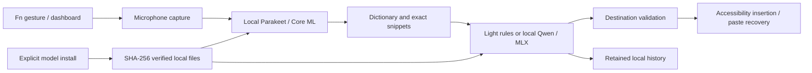

# Architecture

Far Flow is a native SwiftUI/AppKit application. The UI and application coordinator run in the main process; inference uses local Core ML and MLX runtimes. There is no Far Flow server or cloud inference service.

## Application layer

`AppModel` coordinates capture, inference, cancellation, insertion and persisted preferences. `AudioCapture` manages input selection and in-memory audio. `ShortcutService` handles Fn gestures through an Accessibility event tap. The dashboard stays in the background for external dictation.

`InsertionService` captures the intended destination at the end of recording and checks it again before insertion. It avoids secure fields and changed destinations. Direct insertion can be verified where an editor exposes enough Accessibility state; an unverified paste request is reported separately and text remains recoverable for copying. Dictation never automatically presses Return in Terminal.

The floating `NSPanel` is nonactivating and draggable. It is 76 × 30 logical points while idle and 224 × 38 while busy. Recording shows a waveform and stop control. Its center position persists across size changes and launches; Reduce Motion disables expansion animation.

## Core layer

`LocalSpeechEngine` loads pinned Parakeet Core ML assets from disk. `LocalCleanupEngine` runs deterministic Light rules for standard style and optionally loads Qwen through MLX for deeper cleanup, custom styles and explicit transforms. Local tokenizers and weights are required; inference has no remote fallback.

The text pipeline handles bilingual dictionary boundaries, exact snippet expansion, filler removal and limited numeric corrections. Protected-span checks reject some unwanted changes to numbers, identifiers, addresses and negation. These checks do not prove semantic equivalence for arbitrary AI rewrites.

`LocalStore` persists versioned user data in SQLite. Model installation uses staging, content hashes and a pinned file manifest. UI history is real retained data in normal use. Documentation screenshots use an isolated profile selected by a preview-only Info.plist key and visibly mark sample data; production builds do not set that key.

## Media bridge

The optional media integration pauses the macOS Now Playing player and resumes it only if Far Flow owned that pause and the player still matches. It uses an original Objective-C bridge loaded by a bundled launcher under the system Perl host. Only player PID and playing state cross the local stdin/stdout transport; track metadata is not needed.

This uses version-dependent private MediaRemote APIs and depends on system Perl availability. It can require maintenance after macOS updates. Players without Now Playing integration may continue playing. The architecture was informed by the primary [mediaremote-adapter project](https://github.com/ungive/mediaremote-adapter).

## Process lifetime

Closing the main window or choosing Quit cancels work, stops capture and shortcuts, closes the panel, unloads local engines and ends the owned media helper. The termination path allows a bounded unload interval; process exit releases any noncancelable model load. Minimize keeps the app running. Models are stored on disk between launches, but no Far Flow model host remains running after the app exits.

## Dependencies

- FluidAudio is pinned to commit `1b0ed50d686873128a4129b3510ce3914c849bab`.
- mlx-swift-lm is pinned to `2.29.3`.
- WhisperKit `1.1.1` supports the benchmark comparison; it is not the app's speech engine.
- Package transitive revisions are recorded in the Xcode workspace's `Package.resolved`.

See [third-party notices](THIRD-PARTY-NOTICES.txt) and [privacy](PRIVACY.md).
